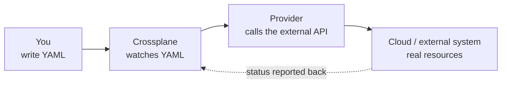
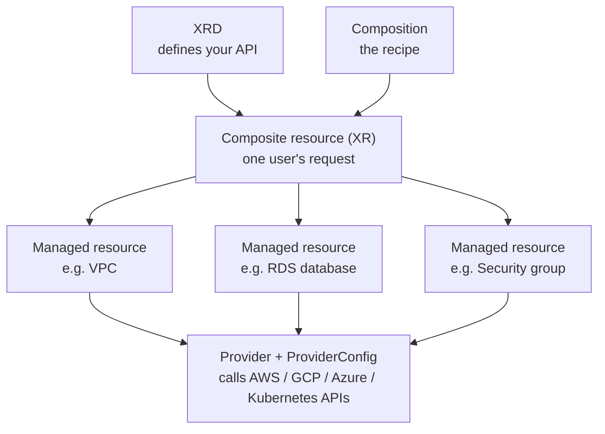
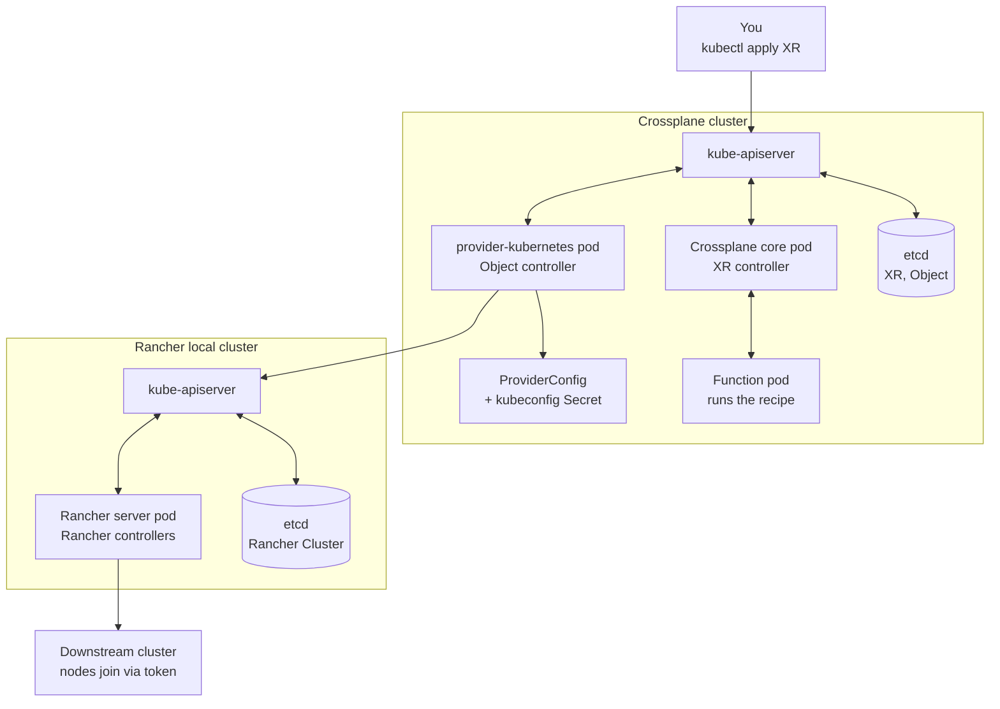
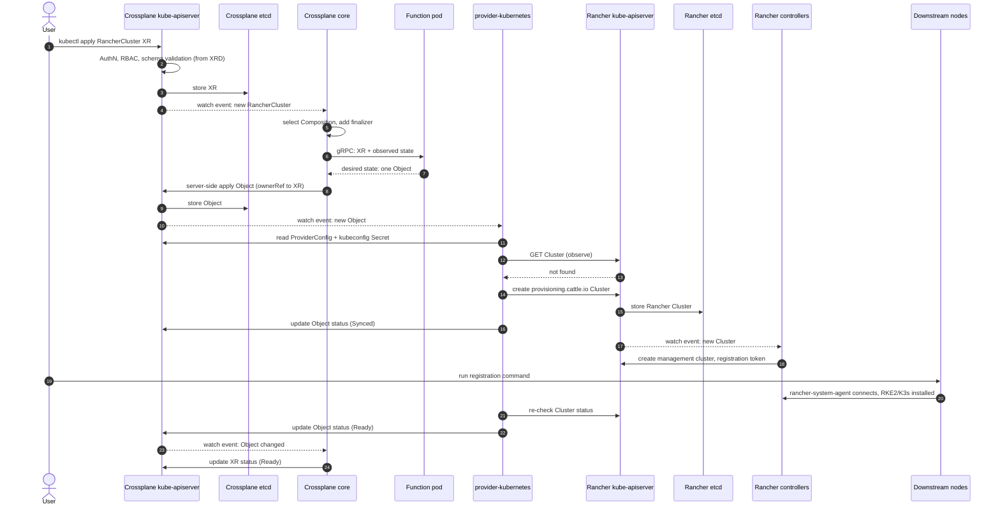
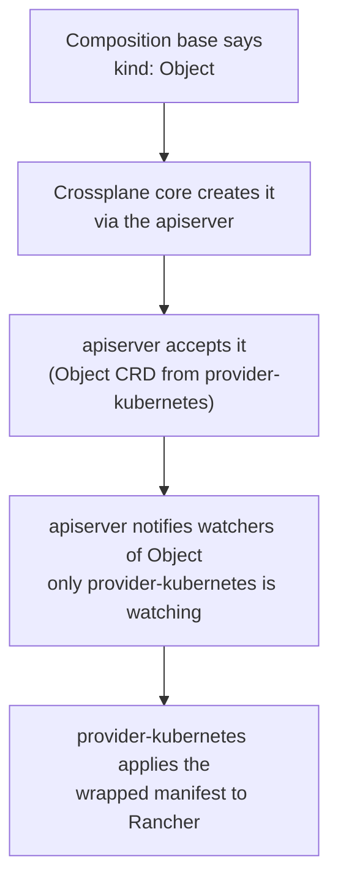
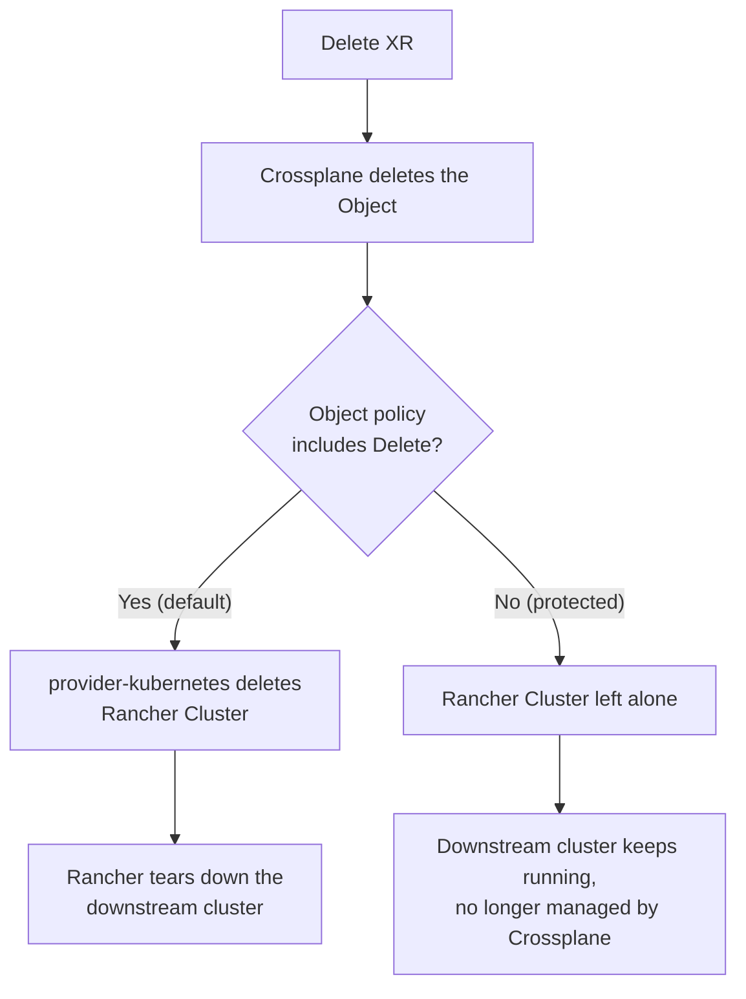

# Crossplane: Concepts, Components and Rancher Cluster Provisioning Flow

A beginner-friendly guide in two parts:

- **Part 1** explains what Crossplane is, its components, how they work, and why you would use it.
- **Part 2** walks through exactly what happens when a Rancher custom downstream cluster is created from a Crossplane XR, using an XRD, a Composition and `provider-kubernetes`.

---

## Table of contents

**Part 1: Crossplane basics**

1. [What is Crossplane?](#1-what-is-crossplane)
2. [Why use Crossplane?](#2-why-use-crossplane)
3. [Components explained](#3-components-explained)
4. [How the components work together](#4-how-the-components-work-together)
5. [How to use Crossplane: getting started](#5-how-to-use-crossplane-getting-started)
6. [Crossplane vs Terraform](#6-crossplane-vs-terraform)

**Part 2: Provisioning Rancher custom clusters**

7. [Our setup at a glance](#7-our-setup-at-a-glance)
8. [Architecture: where everything runs](#8-architecture-where-everything-runs)
9. [The Object: an envelope around the Rancher Cluster](#9-the-object-an-envelope-around-the-rancher-cluster)
10. [Example manifests](#10-example-manifests)
11. [End-to-end flow when an XR is applied](#11-end-to-end-flow-when-an-xr-is-applied)
12. [How each controller knows what to handle](#12-how-each-controller-knows-what-to-handle)
13. [Continuous reconciliation](#13-continuous-reconciliation)
14. [Deletion behavior and protection](#14-deletion-behavior-and-protection)
15. [Troubleshooting](#15-troubleshooting)
16. [Useful commands](#16-useful-commands)

---

# Part 1: Crossplane basics

## 1. What is Crossplane?

**Crossplane is an open-source Kubernetes add-on that lets you create and manage infrastructure (databases, buckets, networks, whole clusters) by writing Kubernetes YAML and running `kubectl apply`**, the same way you already create Pods and Deployments.

### The idea it builds on

Kubernetes already works like this:

1. You write YAML saying what you want: *"3 replicas of nginx."*
2. Kubernetes stores it.
3. A **controller** keeps comparing what you asked for with what actually exists, and fixes any difference. If a Pod dies, a new one is started.

This loop (*desired state → compare → fix → repeat*) is called **reconciliation**.

Crossplane uses this same pattern for things **outside** the cluster:

1. You write YAML saying *"I want an S3 bucket in ap-south-1."*
2. Kubernetes stores it.
3. A Crossplane controller calls the AWS API to create the bucket, then keeps checking. If someone deletes the bucket manually, it is recreated.



Status also flows back: once the resource exists, Crossplane writes `Ready: True` into the object's status, so `kubectl get` shows whether the real resource is healthy.

### An analogy: a restaurant

| Restaurant | Crossplane |
|---|---|
| Manager who takes orders and coordinates the kitchen | Crossplane core |
| Chefs, each specialised in one cuisine | Providers (AWS, GCP, Kubernetes, Helm…) |
| Keys to each kitchen | ProviderConfig (credentials) |
| A single dish | Managed resource |
| The menu | XRD (your custom API) |
| The recipe behind each menu item | Composition |
| A customer's order | XR (composite resource) |

---

## 2. Why use Crossplane?

- **Self-service platforms.** Platform teams offer a simple "order form" (an XRD), e.g. `kind: AppDatabase` with `size` and `region`. Developers request infrastructure without needing cloud access or knowing every low-level setting. The platform team controls security and defaults in the recipe.
- **Automatic drift correction.** Crossplane keeps checking. Manual changes made in a console are reverted to what the YAML says.
- **GitOps for infrastructure.** Because everything is YAML, Argo CD or Flux can deploy infrastructure from Git, exactly like applications.
- **One workflow for many systems.** AWS, GCP, Azure, Helm releases and other Kubernetes clusters are all managed with `kubectl` and the same patterns.
- **Kubernetes-native tooling.** RBAC, namespaces, `kubectl describe`, events, and monitoring all work the same way as for any Kubernetes resource.
- **Managing other clusters.** With `provider-kubernetes`, Crossplane can create and maintain objects inside remote clusters. Part 2 uses this to create Rancher downstream clusters.

---

## 3. Components explained

### 3.1 Crossplane core

The "manager". A set of controllers installed into the cluster (usually with Helm), running in the `crossplane-system` namespace as two pods: `crossplane` and `crossplane-rbac-manager`.

**Crossplane core never talks to AWS, GCP, Rancher or any external API itself.** Providers do that. Core has three jobs:

**a) Package manager.** When you apply a `Provider`, `Function` or `Configuration`, core:
- pulls the package (an OCI image) from a registry,
- installs the CRDs it contains (this is how kinds like `Bucket` or `Object` appear in the cluster),
- starts the provider or function as a Deployment,
- resolves dependencies (a Configuration can require a provider),
- manages upgrades as *revisions*, so you can roll back.

**b) Composition engine.** The most important job:
- When an **XRD** is created, core generates a new CRD from it, so Kubernetes accepts your custom kind.
- Core starts a controller that watches for XRs of that kind.
- For each XR, core picks the matching **Composition**, runs its function pipeline, and creates/updates/deletes the resulting managed resources.
- Core collects the status of those managed resources and reports it on the XR, so the XR is Ready only when everything underneath is Ready.

**c) RBAC manager.** Automatically creates the Kubernetes roles that providers need for their resource types, and roles that can be granted to users for your custom XR kinds.

> In short: **core understands *what you want* and breaks it into pieces; providers know *how to build* each piece.**

### 3.2 Providers

A provider is a pod that knows how to talk to **one external API**. Installing a provider:
- adds new resource types (CRDs) to the cluster, one per kind of external thing,
- starts controllers that watch those types and call the external API.

Common providers:

| Provider | Example managed resources | One resource equals… |
|---|---|---|
| `provider-kubernetes` | `Object`, `ObservedObjectCollection` | one Kubernetes object in a target cluster |
| `provider-helm` | `Release` | one Helm release in a target cluster |
| `provider-aws-*` | `Bucket`, `VPC`, `Subnet`, `SecurityGroup`, `Instance` (RDS), `Cluster` (EKS), `Role` (IAM) | one AWS resource |
| `provider-gcp-*` | `Bucket`, `Network`, `DatabaseInstance`, `Cluster` (GKE) | one GCP resource |
| `provider-azure-*` | `ResourceGroup`, `VirtualNetwork`, `KubernetesCluster` (AKS) | one Azure resource |
| `provider-terraform` | `Workspace` | one Terraform run/state |
| `provider-http` | `Request` | one HTTP API call result |

The full list of resource types per provider is on the Upbound Marketplace (marketplace.upbound.io).

### 3.3 ProviderConfig

The "keys to the kitchen". Tells a provider which credentials and endpoint to use, for example a Kubernetes Secret holding AWS keys, an IRSA role, or a kubeconfig for another cluster. Without it, the provider cannot log in.

### 3.4 Managed resources (MRs)

**One managed resource = exactly one real thing outside Crossplane**, kept in sync by a provider.

- A `Bucket` MR = one S3 bucket.
- An `Object` MR = one Kubernetes object in a target cluster.

MRs are the low-level building blocks. Crossplane core ships **no** MRs; every MR type comes from a provider. Each MR has:
- `spec.forProvider`: the desired settings of the external resource,
- `spec.providerConfigRef`: which credentials to use,
- deletion settings (`managementPolicies` / `deletionPolicy`),
- `status`: what the provider observed, plus `Synced` and `Ready` conditions.

All MR types are tagged with the category `managed`, so `kubectl get managed` lists every MR in the cluster.

### 3.5 Composite Resource Definition (XRD)

The "menu". Defines **your own custom API**. For example, `kind: AppDatabase` with only `size` and `region`, hiding the dozens of fields a real database needs. Crossplane core reads the XRD and generates a CRD for the new kind.

### 3.6 Composition

The "recipe". Says: *when someone creates an `AppDatabase`, create these managed resources, filled in like this.* A Composition targets one XR kind (`compositeTypeRef`) and is written as a **pipeline of composition functions**.

### 3.7 Composition functions

Small plugins that run Composition steps, each as its own pod. Crossplane core sends them the XR and the current state over gRPC; they return the desired managed resources. Common ones:
- `function-patch-and-transform`: templates plus "copy this field from the XR into that field of the MR" patches,
- `function-go-templating`: Go templates,
- `function-auto-ready`: marks the XR Ready when its resources are Ready.

### 3.8 Composite resource (XR)

The "order". One request that uses your XRD's API, e.g. `AppDatabase: orders-db`. Crossplane core runs the Composition for it and creates the managed resources. The XR is the **parent**; the MRs it creates are its **children**.

> **Version note:** Crossplane v2 (2025) makes XRs and MRs namespaced by default and drops the separate "Claim" object for new designs. Older tutorials that use Claims describe the v1 approach.

### 3.9 Packages: Configurations

A way to bundle XRDs, Compositions and their dependencies into one versioned OCI package, so an entire platform API can be installed into another cluster in a single step.

### 3.10 What is *not* a managed resource

`Provider`, `Function`, `Configuration` (packages), `ProviderConfig` (credentials), `XRD` and `Composition` (API and recipe), and XRs (they *create* MRs but don't map to one external thing).

---

## 4. How the components work together



- **Written once by the platform team:** XRD and Composition.
- **Created by users:** XRs.
- **Generated by Crossplane:** managed resources.
- **Acted on by providers:** managed resources are turned into real external resources.

### The general flow

1. A user applies an XR.
2. Crossplane core picks the Composition and runs its functions.
3. Core creates the managed resources the functions return.
4. Each provider notices the MRs of its own kinds and calls its external API.
5. Providers report status on the MRs; core rolls it up onto the XR.
6. Everything keeps reconciling: changes to the XR flow down, and drift in the external system is corrected.

---

## 5. How to use Crossplane: getting started

### Step 1: Install Crossplane core

```bash
helm repo add crossplane-stable https://charts.crossplane.io/stable
helm repo update
helm install crossplane crossplane-stable/crossplane \
  -n crossplane-system --create-namespace

kubectl get pods -n crossplane-system
```

### Step 2: Install a provider

```yaml
apiVersion: pkg.crossplane.io/v1
kind: Provider
metadata:
  name: provider-aws-s3
spec:
  package: xpkg.upbound.io/upbound/provider-aws-s3:v1
```

```bash
kubectl apply -f provider.yaml
kubectl get providers          # wait for INSTALLED=True, HEALTHY=True
```

### Step 3: Give it credentials

Create a Secret with credentials and a `ProviderConfig` that references it (format depends on the provider).

### Step 4: Create a managed resource directly

```yaml
apiVersion: s3.aws.upbound.io/v1beta1
kind: Bucket
metadata:
  name: my-first-bucket
spec:
  forProvider:
    region: ap-south-1
  providerConfigRef:
    name: default
```

```bash
kubectl apply -f bucket.yaml
kubectl get bucket             # READY=True means it exists in AWS
kubectl delete -f bucket.yaml  # deletes the real bucket too (default policy)
```

### Step 5: Build your own API

Once comfortable with MRs, define an XRD and Composition so others can request infrastructure through a simple API. Part 2 shows a complete example.

---

## 6. Crossplane vs Terraform

| | Terraform | Crossplane |
|---|---|---|
| When it runs | Only when you run `terraform apply` | Continuously, as controllers in Kubernetes |
| State | State file | Kubernetes API (etcd) |
| Drift | Detected on next plan/apply | Detected and corrected automatically |
| Interface | HCL + CLI | Kubernetes YAML + `kubectl` |
| Self-service APIs | Modules | XRDs + Compositions, with Kubernetes RBAC |
| Good fit | Simple or one-off setups | Always-on, self-service platforms built on Kubernetes |

---

# Part 2: Provisioning Rancher custom clusters

## 7. Our setup at a glance

In this setup, the "external system" is **not a cloud provider**. It is the Kubernetes API of the **Rancher management (local) cluster**. Crossplane writes a Rancher `provisioning.cattle.io/v1 Cluster` object there, and **Rancher itself** turns that object into a real downstream cluster.

> Crossplane writes and guards the Rancher `Cluster` object. Rancher builds the cluster.

How each Crossplane component maps to this setup:

| Component | In this setup |
|---|---|
| Crossplane core | Watches `RancherCluster` XRs and creates `Object`s from the Composition |
| Provider | `provider-kubernetes`: applies Kubernetes manifests to a target cluster and keeps them in sync |
| ProviderConfig | Points to a Secret with the Rancher local cluster's kubeconfig (or in-cluster identity if Crossplane runs on the Rancher local cluster) |
| Managed resource | `Object` (`kubernetes.crossplane.io`): one `Object` = one Rancher `Cluster` definition |
| XRD | Defines `kind: RancherCluster` with a few fields (name, Kubernetes version) |
| Composition | Creates one `Object` wrapping a Rancher `Cluster`, copying values from the XR |
| Function | `function-patch-and-transform` fills the `Object` template from the XR |
| XR | `RancherCluster: team-a` = "please create cluster team-a" |
| "External system" | Rancher local cluster; Rancher controllers create the downstream cluster |

---

## 8. Architecture: where everything runs

Crossplane may run on the Rancher local cluster itself or on a separate cluster. The flow is the same either way; if it is the same cluster, the two boxes below share one apiserver and one etcd.



**Key rule:** controllers never talk to etcd directly. Everything goes through the **kube-apiserver**, which is the only component that reads and writes etcd. Controllers learn about changes by **watching** the apiserver.

---

## 9. The Object: an envelope around the Rancher Cluster

Without Crossplane, you would apply this directly to the Rancher local cluster (this is what the Rancher UI does for **Create → Custom**):

```yaml
apiVersion: provisioning.cattle.io/v1
kind: Cluster
metadata:
  name: team-a
  namespace: fleet-default
spec:
  kubernetesVersion: v1.30.x+rke2r1   # example
  rkeConfig: {}
```

Crossplane cannot manage a Rancher `Cluster` directly, because it only manages its own resource types. `provider-kubernetes` solves this with a generic MR called `Object`, which **wraps** that exact manifest under `spec.forProvider.manifest`:

```yaml
# ---------- THE ENVELOPE (read by Crossplane / provider-kubernetes) ----------
apiVersion: kubernetes.crossplane.io/v1alpha2
kind: Object
metadata:
  name: team-a-cluster
spec:
  providerConfigRef:
    name: rancher-local                # deliver to the Rancher local cluster
  forProvider:
    manifest:
      # ---------- THE LETTER (created in Rancher) ----------
      apiVersion: provisioning.cattle.io/v1
      kind: Cluster
      metadata:
        name: team-a
        namespace: fleet-default
      spec:
        kubernetesVersion: v1.30.x+rke2r1
        rkeConfig: {}
```

- **Outer part:** instructions for Crossplane (target cluster, deletion behavior, readiness).
- **Inner part:** exactly what gets created in Rancher.
- **One `Object` = one Rancher `Cluster`.** Ten downstream clusters = ten `Object`s.

**Why wrap at all?** The envelope adds continuous drift correction, composition from a simple XR, and one control point with consistent deletion protection and status reporting.

In this setup, `Object`s are **not written by hand**. They are generated by the Composition from each XR.

---

## 10. Example manifests

> Examples are simplified. API versions are for illustration; check them against the Crossplane and provider-kubernetes versions you run.

### 10.1 XRD: defines the `RancherCluster` API

```yaml
apiVersion: apiextensions.crossplane.io/v1
kind: CompositeResourceDefinition
metadata:
  name: rancherclusters.platform.example.com
spec:
  group: platform.example.com
  names:
    kind: RancherCluster
    plural: rancherclusters
  versions:
  - name: v1alpha1
    served: true
    referenceable: true
    schema:
      openAPIV3Schema:
        type: object
        properties:
          spec:
            type: object
            properties:
              clusterName:
                type: string
              kubernetesVersion:
                type: string
            required: [clusterName, kubernetesVersion]
```

### 10.2 Composition: the recipe

```yaml
apiVersion: apiextensions.crossplane.io/v1
kind: Composition
metadata:
  name: rancher-cluster
spec:
  compositeTypeRef:                       # this recipe is for RancherCluster XRs
    apiVersion: platform.example.com/v1alpha1
    kind: RancherCluster
  mode: Pipeline
  pipeline:
  - step: create-cluster
    functionRef:
      name: function-patch-and-transform
    input:
      apiVersion: pt.fn.crossplane.io/v1beta1
      kind: Resources
      resources:
      - name: rancher-cluster
        base:
          apiVersion: kubernetes.crossplane.io/v1alpha2   # <- tells core to create an Object
          kind: Object
          spec:
            # Protect the real cluster: no "Delete" in the list
            managementPolicies: ["Observe", "Create", "Update", "LateInitialize"]
            # Ready only when the Rancher Cluster reports Ready
            readiness:
              policy: DeriveFromObject
            providerConfigRef:
              name: rancher-local
            forProvider:
              manifest:
                apiVersion: provisioning.cattle.io/v1
                kind: Cluster
                metadata:
                  namespace: fleet-default
                spec:
                  rkeConfig: {}
        patches:
        - type: FromCompositeFieldPath
          fromFieldPath: spec.clusterName
          toFieldPath: spec.forProvider.manifest.metadata.name
        - type: FromCompositeFieldPath
          fromFieldPath: spec.kubernetesVersion
          toFieldPath: spec.forProvider.manifest.spec.kubernetesVersion
```

### 10.3 XR: one cluster request

```yaml
apiVersion: platform.example.com/v1alpha1
kind: RancherCluster
metadata:
  name: team-a
spec:
  clusterName: team-a
  kubernetesVersion: v1.30.x+rke2r1
```

---

## 11. End-to-end flow when an XR is applied

### 11.1 Sequence diagram



### 11.2 Before any XR (one-time setup)

Already stored in etcd and running:

- **XRD**: Crossplane core read it and generated the `RancherCluster` CRD, so the apiserver accepts XRs of that kind.
- **Composition**: the recipe for `RancherCluster`.
- **Function**: running as a pod (e.g. `function-patch-and-transform`).
- **provider-kubernetes**: running as a pod; installed the `Object` CRD.
- **ProviderConfig**: points to the Rancher local cluster's kubeconfig Secret.

Crossplane core and provider-kubernetes both hold open **watches** on the apiserver.

### 11.3 Phase 1: the XR enters the cluster

1. **`kubectl apply`** sends the XR to the Crossplane cluster's kube-apiserver.
2. **The apiserver checks it:** authentication, RBAC (may you create `RancherCluster`?), schema validation from the XRD, admission webhooks. Invalid input is rejected here and nothing else happens.
3. **The apiserver stores the XR in etcd.** Only a record exists at this point; nothing has been created in Rancher yet.

### 11.4 Phase 2: Crossplane core turns the XR into an Object

4. **Core is notified** through its watch on `RancherCluster`.
5. **Core selects a Composition** (via `compositionRef`, `compositionSelector`, or the XRD default) and adds a finalizer to the XR so it can't disappear before cleanup.
6. **Core runs the pipeline**, sending the XR and the observed state of existing composed resources (none on the first run) to the function pod over gRPC.
7. **The function returns the desired state**: one `Object`, built from the `base` template with values patched in from the XR.
8. **Core applies the `Object`** through the apiserver (server-side apply). It is stored in etcd with:
   - label `crossplane.io/composite: <xr-name>`
   - an `ownerReference` pointing to the XR (parent/child link)

### 11.5 Phase 3: provider-kubernetes delivers the manifest to Rancher

9. **provider-kubernetes is notified** through its watch on `Object`.
10. **It loads credentials** from the `ProviderConfig` and its kubeconfig Secret, and builds a client for the Rancher local cluster.
11. **Observe:** it asks the Rancher apiserver whether `Cluster team-a` exists in `fleet-default`. First time: no.
12. **Create:** it sends the wrapped manifest. The Rancher apiserver authenticates the kubeconfig identity, validates the object, and stores it in **the Rancher local cluster's etcd**.
13. **It updates the `Object`'s status** (`Synced: True`; `Ready` per the readiness policy).

### 11.6 Phase 4: Rancher creates the cluster

14. **Rancher controllers are notified** through their own watch on `provisioning.cattle.io` `Cluster`.
15. **Rancher creates** the management cluster entry (`c-m-xxxxx`), the cluster registration token and related RBAC. The cluster appears in the Rancher UI waiting for nodes.
16. **Nodes are registered manually** with the token command (outside Crossplane). `rancher-system-agent` on each node connects back to Rancher and RKE2/K3s is installed. The cluster becomes Active.

### 11.7 Phase 5: status flows back up

17. **provider-kubernetes re-checks** the Rancher `Cluster` and updates the `Object`'s status.
18. **Crossplane core** sees the `Object` change and rolls it up into the XR. When all composed resources are Ready, the XR shows `READY: True`.

> **Readiness note:** by default an `Object` is Ready as soon as the manifest is applied, even with no nodes joined. `readiness.policy: DeriveFromObject` makes it follow the Rancher `Cluster`'s own Ready condition instead.

---

## 12. How each controller knows what to handle

Crossplane core is generic. It does **not** know what an `Object` is. It creates whatever the Composition's function returns; the Composition's `base` says `apiVersion: kubernetes.crossplane.io/v1alpha2`, `kind: Object`. If the base said `kind: Bucket` with an AWS apiVersion, core would create a `Bucket` instead.

- The **apiserver accepts** the `Object` only because provider-kubernetes installed its CRD. Without the provider: `no matches for kind "Object"`, visible in `kubectl describe` on the XR.
- Each controller **watches only its own kinds**. The `apiVersion` + `kind` act as the address label; the apiserver is the post office. Core and the provider never talk to each other directly.

| Kind | apiVersion group | Watched by |
|---|---|---|
| `RancherCluster` (XR) | `platform.example.com` (your XRD) | Crossplane core |
| `Object` | `kubernetes.crossplane.io` | provider-kubernetes |
| `Cluster` | `provisioning.cattle.io` | Rancher controllers |



---

## 13. Continuous reconciliation

This is not a one-time script. Both controllers keep running:

- **Crossplane core** re-runs the Composition when the XR changes (for example, a new `kubernetesVersion`) and updates the `Object`.
- **provider-kubernetes** periodically compares the `Object`'s manifest with the real Rancher `Cluster`. Manual edits to the Rancher `Cluster` are reverted to match the manifest.

---

## 14. Deletion behavior and protection

### 14.1 What gets deleted

Deleting an XR **always deletes the `Object`s it composed** (they are its children). Whether the **real Rancher cluster** survives depends on the `Object`'s policy.



| What is deleted | Default policy | Protected (no `Delete` / `Orphan`) |
|---|---|---|
| XR | Object deleted, **Rancher cluster destroyed** | Object deleted, **cluster survives** |
| `Object` only (owned by an XR) | Cluster destroyed, then Object recreated by the XR (new empty cluster) | Cluster survives, Object recreated |
| `Object` created directly (no XR) | Cluster destroyed | Cluster survives, unmanaged |

### 14.2 Protection options

- **`managementPolicies` without `Delete`** on the `Object` (or the older `deletionPolicy: Orphan`). Set it **in the Composition** so every generated `Object` is protected.
- **Crossplane `Usage`**: blocks a deletion request up front while a resource is in use.
- **RBAC**: restrict `delete` on XRs and `Object`s to a small group.
- **GitOps**: if Argo CD or Flux manages these resources, disable pruning (or require confirmation) for them.

Test the chosen protection on a throwaway cluster before relying on it.

---

## 15. Troubleshooting

| Symptom | Stuck at | Check |
|---|---|---|
| `kubectl apply` rejected | Steps 1–3 | Error message; XRD schema; RBAC |
| XR exists, no `Object` | Steps 4–8 | `kubectl describe` the XR; Crossplane and function pod logs; Composition selection |
| `Object` exists, `Synced: False` | Steps 9–13 | `kubectl describe object`; provider-kubernetes logs; ProviderConfig and kubeconfig Secret |
| Rancher `Cluster` exists but stuck | Steps 14–16 | Rancher UI; Rancher server logs; node registration and `rancher-system-agent` |
| XR never becomes Ready | Steps 17–18 | Readiness policy on the `Object`; Rancher `Cluster` conditions |

---

## 16. Useful commands

```bash
# Crossplane components
kubectl get pods -n crossplane-system
kubectl get providers
kubectl get functions
kubectl get xrd
kubectl get compositions

# Your XRs and what they created
kubectl get rancherclusters
kubectl describe rancherclusters team-a
kubectl get managed -L crossplane.io/composite    # all MRs + owning XR

# The Object (envelope)
kubectl get objects
kubectl describe object <name>
kubectl get object <name> -o yaml                  # labels, ownerReferences, status

# Confirm the Object CRD exists (installed by provider-kubernetes)
kubectl get crd objects.kubernetes.crossplane.io

# On the Rancher local cluster: the delivered Rancher Cluster
kubectl get clusters.provisioning.cattle.io -n fleet-default
```
